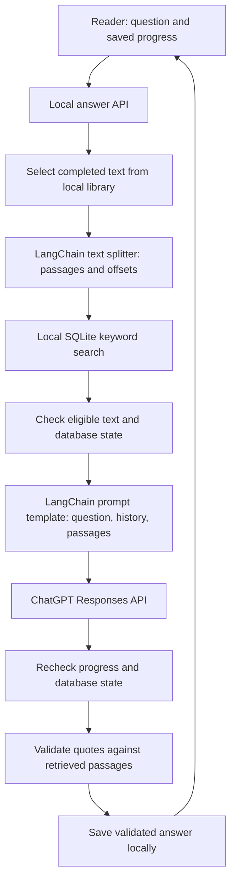

# Architecture and data flow

Spoiless runs the Vue interface and FastAPI backend on the reader's computer. The library, confirmed chapter boundaries, progress, cached embeddings, and conversation history live in a local SQLite database. ChatGPT credentials are stored separately in the operating system credential store. Imported EPUB navigation entries are suggestions until the reader confirms the chapter boundaries.

For a book question, the current flow is:

The current chapter is unread. The backend selects eligible text **before** splitting or indexing, and checks progress and chapter boundaries again before the request, after the response, and before saving. It withholds results when the relevant state changes. There is still a small race before a request starts, and content sent during an already-started request cannot be recalled. Citation checks match exact quotes to supplied passages; they do not prove that each generated claim is supported or that the answer is spoiler-free. See [answer safety](answer-safety.md).

The LangChain splitter runs locally and prefers paragraph boundaries. Spoiless checks the resulting source offsets before using them. Changing passage boundaries can change search rankings and citations. LangChain's prompt template formats the question request; Spoiless retains the eligibility checks, account handling, model request, and citation validation. LangChain adds dependencies and does not itself enforce the reader's progress or prevent hallucinations. No general-purpose agent or LangChain vector database is used in this flow.

The separate hybrid-search endpoint combines local keyword and semantic rankings after the same eligibility filtering. It requires a local embedding model; the app offers an explicit model setup action. It reuses cached embeddings for matching eligible passages. The question flow currently uses keyword retrieval, not hybrid search. Recaps use selected completed text and their own bounded, citation-checked workflow rather than the question retrieval flow.

The question, eligible passages, and up to four recent active question-and-answer turns may be sent to OpenAI when the reader requests an answer. The local API checks for an explicit same-origin action. The live model flow remains unverified; the [offline evaluation](retrieval-evaluation.md) uses simulated responses and a small synthetic book.
